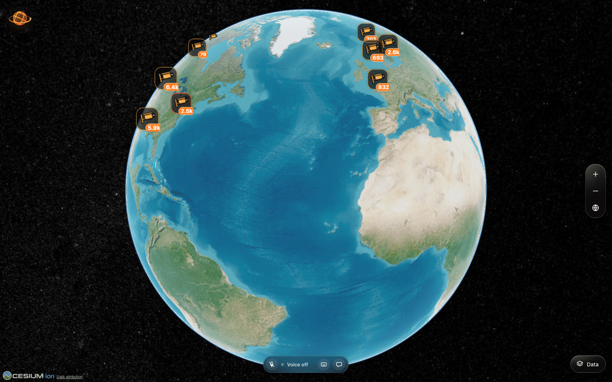
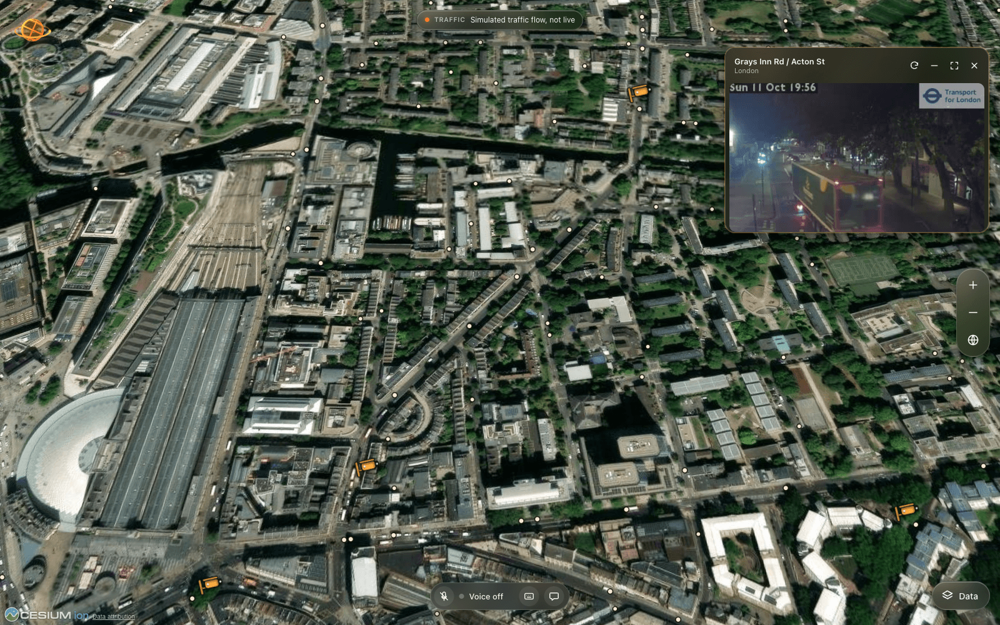
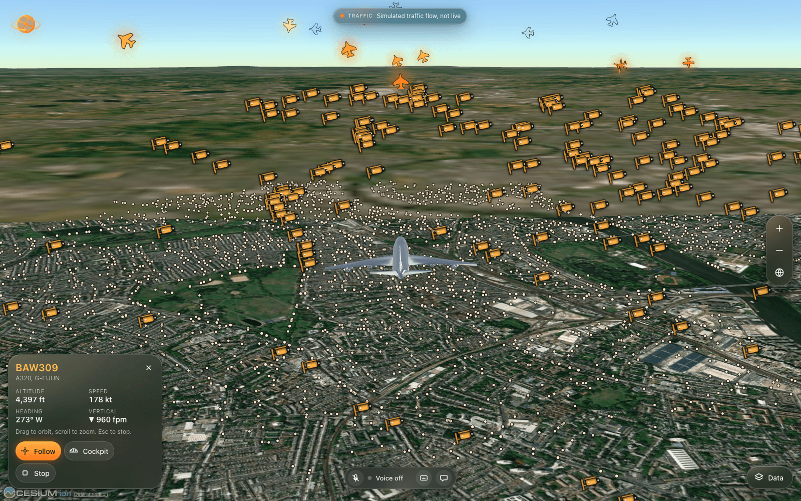
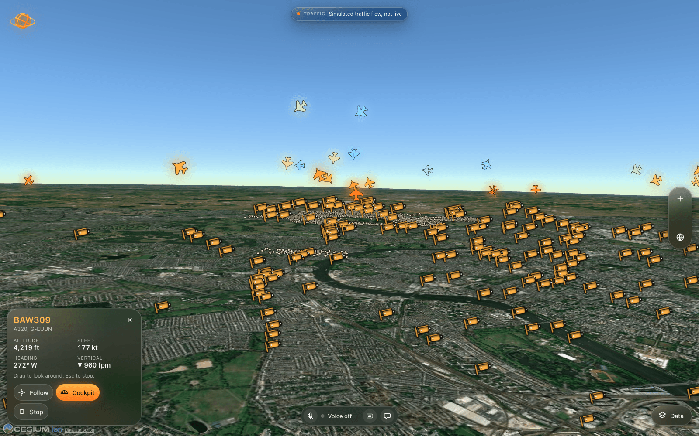

<p align="center">
  
</p>

<h1 align="center">Pheonix</h1>

<p align="center">
  An immersive 3D globe for exploring public cameras around the world, with live aircraft and a local voice assistant.
</p>

<p align="center">
  
  
  
</p>

## What it is

Pheonix is a fullscreen globe you can fly around. Over 20,000 public cameras from traffic agencies and city
open data portals show up as markers. Click one and a floating glass window plays its feed. You can also turn on
live aircraft, simulated traffic, transit vehicles, bike share stations and place labels, and you can follow a
plane or sit in its cockpit.

You can talk to it. Say "Hey Pheonix, take me to Tokyo" and it flies there. Speech recognition, speech
synthesis and the wake word all run on your own machine, so no audio leaves it.

## Screenshots

<p align="center">
  
</p>

<table>
  <tr>
    <td width="50%"><br><sub>A public camera in London, opened from its marker.</sub></td>
    <td width="50%"><br><sub>Following a live aircraft with the chase camera.</sub></td>
  </tr>
  <tr>
    <td width="50%"><br><sub>Cockpit view from the same aircraft.</sub></td>
    <td width="50%"><br><sub>The loading screen with the 3D phoenix.</sub></td>
  </tr>
</table>

## Features

- Fullscreen CesiumJS globe on keyless satellite imagery and terrain, with trackpad and mouse zoom toward the cursor.
- Camera markers that cluster at low zoom, show a field of view cone up close, and are red for live video and amber for still snapshots.
- A floating player that is draggable and resizable, with a grid mode for watching several cameras at once.
- Data menu with live aircraft, simulated traffic, transit, bike share and location labels. All start on except labels.
- Aircraft follow mode and cockpit view, with 3D models up close and smooth motion between data updates.
- Voice commands for places, addresses, cameras, aircraft and layers. A chat panel and a typed command box do the same.
- A procedural 3D phoenix for the loading screen and a 3D globe as the app mark.

## How it works

The browser app is plain ES modules. CesiumJS draws the globe. Three.js is only used for the logo and the
globe mark, in its own canvas, so it never competes with the map for the GPU.

Everything the browser cannot fetch directly goes through small proxy routes that run inside the Vite dev
and preview server (`/api/cctv`, `/api/aircraft`, and the traffic, transit and bikes routes). They cache
responses, throttle upstream calls, and only ever fetch URLs that the server itself registered.

Cameras:

1. Each source has one loader in `server/cameras/providers/`. The catalog merges them, removes duplicates
   and caches the result for 15 minutes.
2. The browser downloads the catalog once (gzip, about 560 KB), keeps it in IndexedDB, and builds a spatial
   index. Markers are drawn as billboards in a single collection, so thousands of cameras stay cheap.
3. A stream only opens when you open a player. Live HLS goes through a bounded puller on the server,
   still cameras refresh as images, and a few embed feeds use the operator's own player.
4. Status is real. The player shows live only when video is actually advancing.

Voice:

1. The browser captures the microphone and streams 16 kHz audio to a local Python service on port 8791.
2. The service matches the wake phrase "hey pheonix" on short local transcripts, records the command until
   you stop talking, and transcribes it with whisper.cpp.
3. A deterministic router turns the text into an action (no language model involved). Replies are spoken with
   Kokoro, using a British male voice.

## Project layout

```
src/app/         startup order and the actions the voice assistant can call
src/globe/       Cesium viewer, camera moves, wheel zoom, place search
src/cameras/     catalog, clusters, markers, field of view, camera layer
src/player/      floating players and stream adapters
src/layers/      aircraft, traffic, transit, bikes, labels (one folder each)
src/voice/       assistant, command router, microphone, chat and pill UI
src/brand/       3D phoenix, 3D globe mark, splash screen
src/ui/          glass shell: zoom buttons, Data menu, toast
server/cameras/  camera providers, catalog, media proxy, routes
server/providers data proxies for aircraft, traffic, transit and bikes
server/voice/    local speech to text, text to speech, wake word (Python)
scripts/         voice setup and the brand asset generator
docs/            architecture, cameras, layers, aircraft, voice, brand
test/            unit tests
```

More detail is in `docs/ARCHITECTURE.md`.

## Getting started

You need Node 22 or newer. Python 3.10 or newer is only needed for voice.

```bash
npm install
npm run dev
```

Open http://localhost:4173. No account, API key or paid service is required.

To build and serve a production bundle:

```bash
npm run build
npm run preview
```

### Voice (optional)

The first run downloads about 0.7 GB of local models into `.voice/`, which is git ignored.

```bash
bash scripts/setup-voice.sh --yes
npm run voice
```

Copy `.env.example` to `.env` to set your name, the assistant name and the voice. Click the microphone in the
capsule at the bottom of the page and allow microphone access. If you do not want to use a microphone, the
keyboard and chat buttons in the same capsule take typed commands.

Some commands to try: "take me to Tokyo", "take me to the nearest camera", "show me a live camera in London",
"follow the nearest plane", "show me traffic in Paris", "1600 Pennsylvania Avenue".

### Tests

```bash
npm test
```

## Limitations

- Only a handful of cameras are live video (the Delaware DOT feeds and some embedded streams in Japan and
  Korea). Everything else is a still image that refreshes. Operators change feeds without notice, so some
  cameras will be offline.
- Traffic is a simulation along real roads, except in New York when NYC DOT speed data is fresh. It is
  labelled as simulated in the app.
- The aircraft source (adsb.lol) rate limits heavy use. Aircraft only draw when you are zoomed in.
- "Hey Pheonix" is matched from local speech recognition because no pretrained wake word model exists for
  that phrase. It is a little less accurate than a trained model.
- The voice setup script was only tested on macOS with Apple Silicon.
- The app runs on the Vite server. Hosting it on a static or serverless platform needs the proxies ported
  to a real server.

## Credits and licenses

Pheonix is MIT licensed. It builds on parts of God's Eye View by Bilawal Sidhu (MIT). Imagery, camera feeds,
aircraft models and voice models each have their own terms, listed in `THIRD_PARTY_NOTICES.md`.
